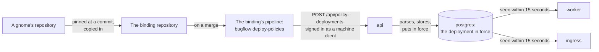
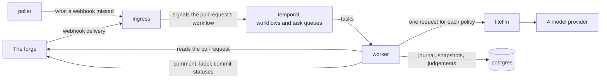
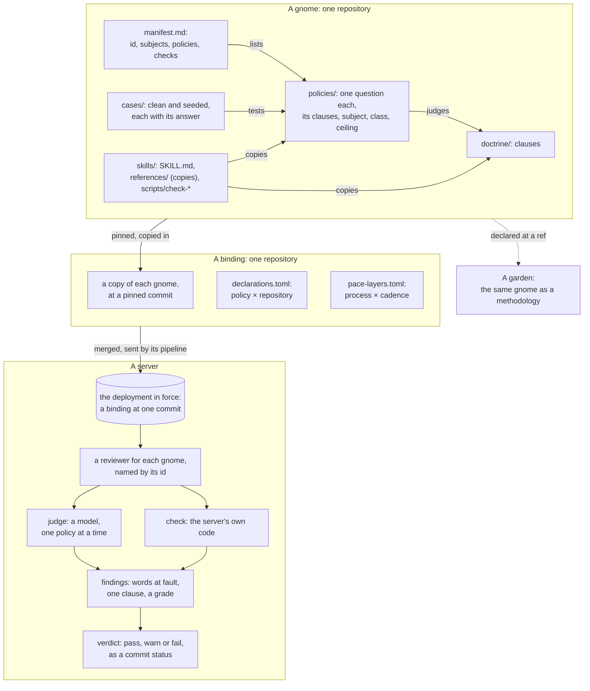

# What is deployed where

What runs on a server, what it talks to, and what has to exist before
it reviews a pull request. [Deploying a server](deploying.md) gives the
commands and the settings. [What a gnome is](gnomes.md) explains the
rules a server reviews by, for a person who maintains them.

[Reading recorded evaluations](evaluation-history.md) describes the Python
readers for journal evidence and retained review content.

## Three kinds of repository

A review needs three kinds of repository, and each has a different
owner.

| Repository | Holds | Changed by |
|---|---|---|
| A gnome | One doctrine, with its policies, cases, checks and skill | Whoever maintains the standard |
| A binding | Which gnomes, at which commits, and which repositories each policy applies to | Whoever decides what an organisation is reviewed for |
| A deployment | The composition and the settings of one server | Whoever operates the server |

A gnome names no server and no repository under review. A binding
holds a copy of each gnome it pins, fetched at one commit, and two
files of its own: `pace-layers.toml` and `declarations.toml`. One
repository may be a gnome and a binding at once, which is the smallest
arrangement: its reviewers and the two files sit side by side.

The repositories under review are a fourth kind. They hold nothing of
the server's. A webhook on each is the only thing a server adds to one.

## How rules reach a server

1. A maintainer changes a gnome in the gnome's own repository.
2. The binding moves its pin to the new commit and copies the gnome in.
3. When that is merged, the binding's pipeline sends the server the
   files it reads: the two binding files and, of each reviewer, the
   manifest, the doctrine and the policies.
4. The API parses the files. If any file has a problem it stores
   nothing and reports every problem. Otherwise it stores the files as
   a policy deployment and puts it in force.
5. The worker and the ingress read the deployment in force once, when
   they start. Each checks every 15 seconds whether another is in
   force, and stops when one is. Compose starts them again, and they
   read the new one.

A server holds no rule of its own. A server that was never sent a
deployment starts, receives deliveries and reviews nothing.

On a pull request in the binding, the pipeline runs the same command
with `--check`. The API parses the files and stores nothing, so a
problem shows before the merge.

## How a pull request is reviewed

1. The forge posts a delivery to the ingress when a pull request is
   opened, pushed to, closed or commented on. The ingress checks the
   delivery's signature against the webhook secret.
2. The ingress signals the workflow that follows that pull request,
   and starts it if there is none. The workflow lives in Temporal, not
   in the ingress or the worker, so it survives a restart of either.
3. The workflow waits until no delivery has arrived for the
   repository's boundary, 60 seconds in the examples. Several pushes
   close together are reviewed once.
4. The workflow starts an evaluation. The worker runs it, one step at
   a time, and Temporal records each step's answer. A step that fails
   is tried again without repeating the steps before it.
5. The steps of an evaluation, each a use case of the `review` context
   unless marked:

   | Step | Use case | What it does |
   |---|---|---|
   | Observe | `observe_pull_request` (`forge`) | Reads the title, description, commits and patches from the forge and stores them as a snapshot |
   | Assess | `judge_pull_request` | Sends a model one policy, the doctrine and the part of the snapshot the policy reads. One step for each policy |
   | Assess | `check_pull_request` | Answers a checked policy in code, with no model |
   | Review | `dispatch_review`, `wait_review`, `collect_review`, `grade_review` | Starts a checkout agent for each reviewer that has one, waits for it, reads its write-up and grades it |
   | Publish | `publish_findings` | Writes one comment, one label, and one commit status for each reviewer |

6. When the pull request closes, the workflow collects its
   conversation once and ends.

The policies asked at "Assess" are the ones `declarations.toml`
declares for the repository. A policy it declares that the worker
cannot answer is left out, with no message on the pull request.

### Task queues

The worker serves three kinds of Temporal task queue.

| Queue | Carries | Rate limit |
|---|---|---|
| The task queue, named by `bugflow_temporal_task_queue` | The workflows, and every step that calls no model | None |
| The queue beside it | Starting and collecting a checkout agent's review | `bugflow_judge_requests_per_second` |
| One for each class of model: small, medium, large | The policies that class answers | The class's own, or the same figure |

A rate limit is held by Temporal for a queue. A provider's quota
belongs to a model, so each class has a queue and a limit of its own.

## What must exist before the first review

| What | Where it is declared | By whom |
|---|---|---|
| The services, their settings and their secrets | The deployment repository and the host | The operator |
| Which repositories the server watches | The setting `bugflow_watched_repositories` | The operator |
| A webhook on each watched repository | The forge, by `bugflow webhooks` | The operator |
| A token that reads pull requests and writes comments, labels and statuses | The worker's settings | The operator |
| A model for each class a policy names | The proxy's `config.yaml` and its keys | The operator |
| A policy deployment in force | The binding repository, through its pipeline | The binding's owner |
| Which policies each repository is judged on | `declarations.toml` in the binding | The binding's owner |
| Where each repository's period begins on each layer | The database, by `bugflow declare --boundary` | The operator |
| What is published to each repository | The database, by `bugflow declare --profile` | The operator |
| What a review may spend | The database, by `bugflow allow` | The operator |

Two of these stop a worker rather than a review. A worker does not
start while a watched repository lacks a boundary on a layer the
deployment holds, and it does not start without a forge token while a
repository is bound to a profile that publishes. Each says what is
missing and stops, and Compose starts it again.

A server matches a repository by its name, `owner/name`. After a
repository is renamed at the forge, the watched repositories, the
binding's declarations, and the boundary, profile and allowance in the
database must each be given the new name.

## The things, and who enforces each

What a gnome, a binding, a deployment and a server are made of, what
contains or points at what, and which code holds each to its form.
[Words](words.md) gives each word one line and says where it is
defined. A gnome is also a methodology to a ClankOS garden, which
installs its skill and runs its checks; `clankos-run help model`
covers that side, and the two models meet at one point only: the
commit a binding pins a gnome at is the ref a garden declares it at.

| Thing | Its form is held by |
|---|---|
| A gnome's files: manifest, doctrine, policies, cases | The policy package parser, which the API runs on every deployment and the binding's pipeline runs with `--check` before a merge. A file with a problem stores nothing and reports every problem |
| The copies in a skill's `references/` | The gnome's own tests, which fail when a copy differs from its original. The server reads the originals and never a copy |
| A skill's `scripts/check-*` | Not this server. A garden's lint runs them |
| The binding's two files | The same parser, as part of a deployment |
| The deployment in force | The API, which stores each deployment and puts the latest in force; the worker and the ingress re-read it within 15 seconds |
| A reviewer's id, subjects and the policies it may ask | The manifest, read at deployment; a declared policy the worker cannot answer is left out |
| A finding's clause | The policy's header: a judge may cite only the clauses the policy lists |
| A grade's ceiling, and the model class | The policy's header, read by the worker when it asks |
| A verdict | The worker, which takes the worst grade among a reviewer's findings on one commit |
| Calibration | Nothing here. This repository has no command that runs one |

## Present limits

- **Calibration is not here.** A gnome's cases are read by a
  calibration, and this repository has no command that runs one.

The [evaluation MCP server](evaluation-mcp.md) is an HTTP API client. It
exchanges the caller's token and relays the API's JSON. It does not open the
database, invoke evaluation use cases or implement a second access policy.
