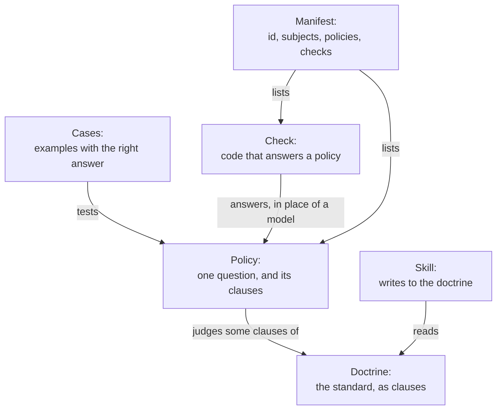

# What a gnome is

For a person who maintains a gnome: what its parts are, who reads each
part, and what has to happen after a change.
[The policy package](policy-package.md) specifies each file's format.
[What is deployed where](architecture.md) explains the server that
reads a gnome.
[Words](words.md) lists what bugflow calls things and where each is
defined.

## The definition

A gnome is a repository that holds an editorial standard for one kind
of thing, and the means to keep to it.

It is named for the thing it judges. A gnome for pull requests judges
titles, descriptions and commit messages. A gnome for a repository's
documents judges those documents.

A gnome has seven parts.

| Part | Where | What it is |
|---|---|---|
| Doctrine | `doctrine/*.md` | The standard, written for a person. A list of clauses |
| Clause | A paragraph of the doctrine | One rule, with an id such as `VOICE-6` and a name |
| Policy | `policies/<ID>-<name>.md` | One question asked about the subject, and the clauses it judges |
| Case | `cases/<ID>/*.md` | An example with the answer a correct judge gives it |
| Check | `skills/<skill>/scripts/check-<name>` | A script that answers a policy in code, with no model |
| Skill | `skills/<skill>/SKILL.md` | Instructions for an agent that writes or tidies to the doctrine |
| Manifest | `manifest.md` | The gnome's id, the lists of its subjects, policies and checks, and the address of its site |

The doctrine and the policies are kept in `doctrine/` and `policies/`
at the root of the gnome. Each skill has a copy of both in its
`references/`, because the tool that installs skills (`npx skills`)
only copies the skill's own directory. The copies are made by a build
step (for example `make skills`). Edit the originals, never a copy.

## How the parts relate

- A gnome has one doctrine. The files of `doctrine/` are joined in
  filename order into one document.
- A policy does not restate the doctrine. Its header lists the clauses
  it judges, and its instructions tell a model how to judge them.
- A finding quotes the words at fault and cites one clause. A policy
  may cite only the clauses its header lists.
- A policy reads one subject, named on its `evidence` line: a part of
  a pull request, one document, or every document of a scope.
- A policy is answered by a model or by a check, and never by both.
- A clause's id is never reused. A retired clause leaves a gap in the
  numbers.

## Who reads a gnome

Two readers use the same files, and nothing in a gnome is written for
one alone.

| Part | A bugflow server | A garden |
|---|---|---|
| Manifest | Reads the id, policies, checks and site | Not read |
| Doctrine | Given to the model with each policy | Read by the skill |
| A policy a model answers | Asked about each pull request, if a binding declares it | Not read |
| A policy a check answers | Answered only if the server has that check | The lint runs the check |
| Cases | Not read. A calibration reads them | Not read |
| A skill's `references/` | Not sent. The server reads the originals | The skill reads its copy |
| The skill's `scripts/` | Not sent to the server | Each `check-<name>` is run by the lint |
| The skill's `SKILL.md` | Not sent to the server | Listed for the garden's agent |

A reader skips what it cannot use. A server renders the subjects it
has code for, so a policy that reads every document of a scope stays
in the gnome for a garden, and a server does not judge it.

### What a server makes of a gnome

A server calls a gnome's directory a reviewer.

- The manifest's `agent_id` is the reviewer's id.
- The reviewer's findings on one commit make one verdict: `pass`,
  `warn` or `fail`, the worst grade among them.
- The server writes one commit status on the pull request, named by
  the reviewer's id.

A server also has checks of its own, written in its code. A manifest's
`checks` line gives one of the gnome's policies to a server's check by
name. That is a different thing from a script in the skill's `scripts/`,
which a garden's lint runs and a server never does.

### What a garden makes of a gnome

To a garden a gnome is a methodology: a repository of skills with
checks, declared in the garden's configuration at a tag and installed
by the ClankOS image. `clankos-run help model` says what a methodology
is on that side. What a gnome holds beyond its skill, the doctrine,
the policies and the cases, a garden never reads.

- Its skill, with the skill's `references/` and `scripts/`, is copied
  into the skills the garden's agent is offered.
- The garden's lint runs each script of the skill named
  `check-<name>`.

## What a gnome does not hold

- Which repositories it applies to, and by which of its policies. A
  binding's `profiles.toml` names sets of its policies, and the
  server's operator sets the gnome on each repository to one.
- When a review runs. A binding's `pace-layers.toml` says that.
- Whether findings are published, and whether a failure blocks a
  merge. The server's operator sets that for each repository.
- What a review may spend. The operator declares that too.
- Which model answers. A policy names a class of model, `small`,
  `medium` or `large`, and each server says which model fills a class.

So one gnome serves any number of servers and gardens unchanged.

## A maintainer's tasks

### Change what a clause says

Edit the clause in `doctrine/`, then run the build step. Then read each
policy that lists the clause, because its instructions were written
against the old words. Measure those policies again.

### Add a clause

Give it the next unused id. A clause that no policy lists is read by
people and by the skill, and no judge reports it. To have it judged,
add a `clause` line to a policy's header, or add a policy.

### Add a policy

Add a file under `policies/`, add its id to the manifest's `policies`
line, and add at least one clean case and one seeded case. A policy is
judged on a server only after a binding declares it for a repository.

### Add a case

A clean case is an example with nothing wrong, and a correct judge
reports nothing. A seeded case has one fault written in, and a correct
judge reports the clause the case expects. Add a case whenever a judge
is found wrong about a real example: the example becomes the case, with
the right answer.

### Measure a policy

A calibration runs one policy over all of its cases and counts the
cases the judge answered correctly. Record the date, the model and the
counts in the policy's calibration notes, below the line
`=== calibration`. Nothing below that line reaches the model, so a
recorded measurement does not change what was measured.

A model's answers vary between runs, so run each measurement twice,
and change one thing between two measurements.

This repository has no command that runs a calibration.

Before a disputed finding becomes a case, `bugflow reproduce
EXCHANGE_ID` on the server asks whether the model would say it again.
A judged finding names the exchange it came from. The command sends
that exchange's request to the model once more and prints the
violations each run found: the same ones point to the policy, and
different ones to the model's variance. It costs one model call, and
the rerun is kept beside the first.

### Copy the doctrine into the skills

After changing anything in `doctrine/` or `policies/`, run the build
step (for example `make skills`). It copies both directories into each
skill's `references/`. The format test fails if a copy is out of date.

### Check the files

A gnome carries a test that every file is in the format its readers
expect. Run it before opening a pull request.

## After a change is merged

A merged change in a gnome reaches nothing by itself.

| Reader | What takes the change |
|---|---|
| A bugflow server | The binding moves its pin to the gnome's new commit and copies the gnome in. When that is merged, the binding's pipeline deploys it, and the server reviews by it within about a minute |
| A garden | The garden moves the tag it declares the gnome at and installs again. Its lint and its skill then use the new files |

A change to the doctrine or to a policy gives the server a new version
of the reviewer. A commit the server judged before is judged again
under the new version, the next time its pull request is evaluated.
